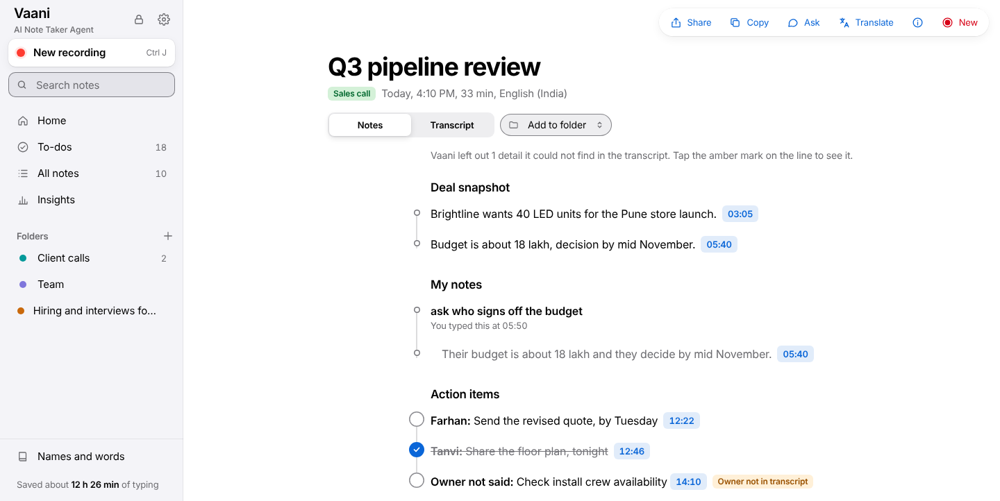
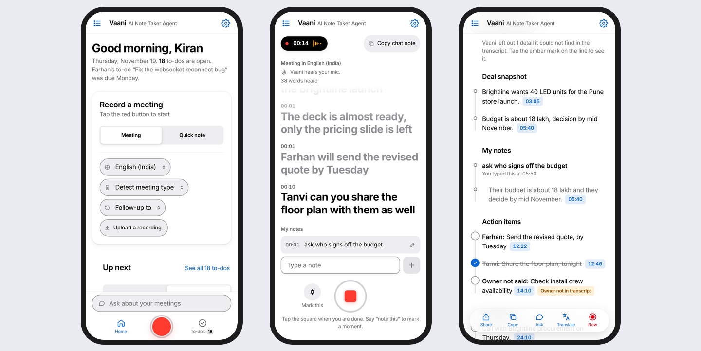

# Vaani

### Just talk. Vaani takes the notes.

**Your free AI note taker agent for Google Meet, Teams and Zoom. It spots the call, writes the notes and drafts the follow-up, in 22 languages.** 
Open source. Hindi, Hinglish, Kannada, Tamil and more. Runs in your browser, and no bot joins your call.

### [▶ Try Vaani now, free](https://pradeep411.github.io/vaani/)

---

## Why Vaani?

Meetings in India switch languages mid-sentence. Most AI note-takers are paid, English-first, upload your recordings, and send a bot into your call. Vaani is the opposite.

- **Free.** No plan, no trial, no credit card.
- **Speaks your language.** 22 languages, and it handles Hinglish-style mixing.
- **Private.** Your audio, transcripts and notes never reach us. They stay in your browser. (With a Sarvam AI key set, the meeting audio goes from your browser to Sarvam AI to be transcribed, never to us.) Where sign-in is switched on, a free account keeps only your email, name and sign-ins, plus simple usage stats if you say yes.
- **One tap.** A red button. Tap, talk, get notes. That's the whole app.

A free, open-source alternative to paid note-takers and dictation apps like Granola, Otter and Wispr Flow, built for how people actually talk.

## How it works

| 1. Tap | 2. Talk | 3. Get notes | 4. Share |
|:---:|:---:|:---:|:---:|
| Press the red button (or <kbd>⌘J</kbd> / <kbd>Ctrl J</kbd>) | Talk normally. Your words appear line by line | Summary, action items, decisions | WhatsApp, email, copy or download |

Screens show a sample meeting. The notes were written by an AI engine; the free basic engine gives simpler notes (see below).

## Features

- 🎙️ **Meeting mode**: live transcript, then notes with a summary, action items, decisions and open questions
- ✍️ **Quick note mode**: speak a thought, get clean, ready-to-send text you can edit
- ✅ **Tickable action items**: tick them off as they get done
- 📝 **My notes**: type your own lines while Vaani listens. Your lines stay word for word, and Vaani adds what was said around them
- 🔎 **Sources you can tap**: points, decisions and tasks show the time they were said, once Vaani has checked it against the transcript. Tap it to read that line
- 💬 **Ask across all your meetings**: "What did Meera promise?", in any language Vaani transcribes. With an AI engine the answer carries numbered sources that open the note at the minute it was said; with none, Vaani shows the closest passages (a basic search, no AI)
- 📆 **Due dates as they were said**: "EOD Friday", "end of the month", "in three days", "by the 25th", *kal*, *parso*, counted from the meeting's date. No date is made up from "last Friday" or "every Monday"
- 🧾 **"Not in transcript" marks**: in AI-written notes, a task owner or due date that Vaani cannot find in the transcript is marked on the line, and that detail is left out of your to-dos, the follow-up email and the calendar link
- ⏳ **Long meetings in one pass**: a long meeting is read whole when your AI provider can take it. When it can't, Vaani reads it in parts and says so on the note
- 🌐 **Translate notes** into 18 languages
- 📤 **Share anywhere**: WhatsApp, email, your phone's share sheet, copy, or download
- 🗂️ **Your notes, searchable**, grouped by day
- 🧠 **Knows what kind of meeting it was**: management, sales, client, developer, founders, customer support and more. Each gets its own format, with owners on every action item
- 🏷️ **Speaker names**: tap a speaker in the transcript and call them "Priya". The name applies to the whole meeting and shows up in exports and in what Ask reads
- 🧩 **Your own note templates**: name a layout and its sections ("Risks: what could go wrong"), pick it before you record or upload. Works with an AI notes engine
- 📁 **Make notes from a recording**: choose an audio or video file (MP3, M4A, WAV, OGG, WebM, MP4; up to 150 MB and 2 hours) and Vaani writes the notes. With a Sarvam AI key the sound goes from your browser straight to Sarvam AI in pieces of under 25 seconds; the file is never saved. A quiet recording is made louder before it is sent; a very long one may be refused on a phone with little memory, with a plain message
- 🌙 **Light and dark mode**, phone and laptop layouts
- 📲 **Install it like an app** on your phone or computer (Add to Home Screen / Install)
- ⏱️ **Time saved counter**: see how much typing you skipped
- 📊 **Insights**: your time saved, speaking pace, streak and to-dos, worked out on your device
- 📅 **Coming up from Google Calendar**: join a call and start notes in one tap
- 👤 **Your account, your call**: where sign-in is switched on, download your data, turn off usage stats or delete your account any time in Settings

## Chrome extension

**Vaani, your AI note taker agent, spots your call.** Join a Google Meet, Microsoft Teams or Zoom call in Chrome and you get a Chrome notification, *Meeting detected. Take notes?*, and a small prompt on the call page. **Start notes** opens Vaani in a slim window beside the call.

- **Hears everyone, with no screen-sharing picker.** Click the Vaani icon on the call tab (or press **Alt+Shift+V**) and Chrome hands the call tab's sound to Vaani, which mixes it with your mic. Chrome allows that only after a click on the icon or the shortcut, so when you start from the notification or the prompt, Vaani begins with your mic and one click on the icon adds everyone to the same notes. The first time, Chrome asks for its OK ("Hear the whole call").
- **Everyone's words in the notes need a Sarvam AI key.** With a key, Sarvam AI turns the whole call into text. Without one, your browser's speech engine can only hear your mic: Vaani says so plainly, keeps the call's audio in the tab until you close it, and offers to make notes from the whole recording once you add a key (or to save it as a file).
- **Knows when the call ends.** It offers to stop the notes, in a notification and in Vaani.
- **Notes in the right format.** Vaani works out whether it was a sales call, a management review, a tech sync or a founders' meeting, and writes the notes to match.
- **No bot joins your call.** Nobody sees a "Vaani is recording" guest.

**Install:** [Vaani on the Chrome Web Store](https://chromewebstore.google.com/detail/fhgpebnbfjmldplhfnlmclkcplbiheof). Version 1.2.0 added the notification, the call hand-over and the call-end prompt. Version 1.3.0 no longer asks while you wait in Google Meet's lobby: it asks once you are in the call. Until the store serves 1.3.0, you can [download the latest extension](https://github.com/Pradeep411/vaani/releases?q=extension), unzip it, open `chrome://extensions`, turn on **Developer mode**, click **Load unpacked** and pick the folder.

The extension is a thin shell around the live app, so app improvements reach you instantly. Read the [privacy page](https://pradeep411.github.io/vaani/privacy.html).

## Insights

**See what all that talking added up to.** Open **Insights** in the sidebar (on a phone, it's in the notes menu).

- **Time saved** against typing at 40 words a minute, and every word you captured
- **Meetings and hours**, quick notes, and your **to-dos**: how many are done, what you owe, what others owe you, and what's overdue
- **Your speaking pace** in words a minute, next to typing. We only compare you with typing, never with other people: Vaani has no data on anyone else.
- **Your streak**, with a map of the last 20 weeks
- **Your busiest day and time**, meeting types, languages, and the people with the most to-dos. Tap a name to see their list.
- **Copy my stats** gives you a short plain-text summary to paste anywhere.

All of it is worked out in your browser from the notes you saved. Nothing is sent anywhere.

## Google Calendar: Coming up

**Your next meetings, right on Home.** Connect Google Calendar in **Settings → Calendar** and a *Coming up* list shows your next 36 hours: time (or "In 12 min"), title, who's invited, and whether it's on Meet, Zoom or Teams.

- **Join and take notes** opens the call. For a Google Meet call with the Chrome extension, Vaani offers to take notes beside the call when it starts, already titled. Otherwise Vaani starts recording your mic in meeting mode, with the note already titled.
- Attendee names help Vaani work out who owns each to-do, on your device. They are not sent to your AI provider unless you turn on **Use attendee first names to write better notes** in Settings → Calendar. It is off until you turn it on; with it on, what Vaani reads as the first name of each person invited goes to your own AI provider with the transcript (never an email address; a name Vaani is unsure of is skipped).
- A quiet reminder appears 5 minutes before a meeting starts.

Vaani reads your next 36 hours of events straight from Google into this browser. None of it goes to your Vaani account or any Vaani database. Disconnect any time: it deletes the saved events and asks Google to remove Vaani's access. If Google can't do that without a fresh sign-in, Vaani says so, and you can remove it under Google Account → Security → Third-party connections (myaccount.google.com/connections). A note you take for an event keeps its attendee names and event id; backups leave them out unless you turn on "Include names and email addresses in backups" in Settings. The access is read-only, the sign-in token lives only in memory, and running your own copy works with your own Google client ID: open the app with `?gcid=1` and use Settings → Calendar → Advanced. Saved events are kept for 36 hours and removed the next time you open Vaani after that.

## The notes engine: free by default, smarter with a key

Vaani never needs an API key. It picks the best engine available, in this order:

| Engine | Cost | Where it runs | What you get |
|---|---|---|---|
| **Your own AI key** (Sarvam AI, OpenAI, Claude or Gemini) | Your key | The provider you choose (text; a Sarvam AI key also gets the audio, for speech to text) | The best notes, any language, Ask and Translate everywhere |
| **On-device AI built into Chrome** | Free | Your computer | Smart notes, Ask and Translate with no key (Chrome on a laptop or desktop that supports it). Chrome downloads it once, when you tap *Download Chrome's on-device AI* in Settings or *Set up Chrome's free on-device AI* under a note. |
| **Vaani's basic engine** | Free | Your device, works offline | Summary, action items and decisions picked out of your words by keywords (no AI) |

Add a key in **Settings → Notes engine**. It is saved only in your browser and sent only to that provider.

- Sarvam AI (best for Indian languages): [dashboard.sarvam.ai](https://dashboard.sarvam.ai)
- Google Gemini (has a free tier): [aistudio.google.com/apikey](https://aistudio.google.com/apikey)
- OpenAI: [platform.openai.com/api-keys](https://platform.openai.com/api-keys)
- Anthropic Claude: [console.anthropic.com/settings/keys](https://console.anthropic.com/settings/keys)

## Speech to text: your browser, or Sarvam AI with your key

By default your browser turns speech into text. It listens for one language at a time, so a meeting in Kannada, Hindi or Tamil mixed with English can come out almost empty when it is set to English.

Save a **Sarvam AI** key and Vaani uses Sarvam AI's speech to text instead (`saaras:v4`, which handles Indian languages mixed with English; the language is detected automatically when you pick English). Vaani records the audio in your browser and sends it straight to Sarvam AI in pieces of about 25 seconds; the words appear as each piece comes back. A piece with no sound in it is not sent, and the note says how much that was. The audio is kept only in memory, never saved, and dropped once it is transcribed. Your "Names and words" list (up to 50 names and terms) is sent to Sarvam AI with the audio as key terms, so names come out right; it also goes to your notes provider with the text. You can switch back in **Settings → Speech to text → This browser**.

Speaker labels are not offered yet: Sarvam AI does them only in its Batch API, which uploads files to cloud storage on another host, and Vaani stays a single page that talks to nothing but the services you choose.

If a recording longer than 3 minutes has very few words (under 25 words, or under 4 a minute), Vaani still writes short notes from what was said, nothing invented, then tells you the likely reason (often: only your mic was heard) and how to fix it.

## Privacy: what runs where

We'd rather be precise than make big promises.

| Step | Where it happens |
|---|---|
| Speech to text | **Your browser's speech engine**, unless you set a Sarvam AI key. Chrome and Edge send the audio to Google or Microsoft to do this. Safari uses Apple's engine. **With a Sarvam AI key set, the meeting audio is sent from your browser to Sarvam AI for transcription, with your Names and words list, and nothing goes to Vaani.** A piece with no sound in it is not sent, and the note says how much that was. Vaani asks once before it starts sending audio to Sarvam AI for a key saved before v2.3. When Vaani hears a call through its Chrome extension, the other people's voices go there too. Without a key, Vaani keeps the meeting's audio only in the tab's memory until you close it, so a failed or mic-only transcript can be redone. Vaani itself never receives your audio. |
| Notes (free engines) | **On your device.** |
| AI (your own key) | **Text goes to the provider you picked** whenever Vaani writes notes, answers a question, recaps your week, translates or drafts a follow-up. With the transcript go the meeting's date and length, the notes you typed while recording, the times you marked and your first name from Settings. If you picked an earlier meeting under "Follow-up to", that meeting's title and its open tasks go along too. Ask sends your question with the few passages of your notes and transcripts that match it (at most 8); Recap sends that week's notes. OpenAI, Claude and Gemini never get the audio; a Sarvam AI key also does speech to text (above). |
| Saved notes | **Only in this browser** (local storage, or IndexedDB when that is full). Clearing browser data deletes them. |
| Insights | **On your device**, from your saved notes. |
| Google Calendar (only if you connect it) | **Straight from Google into this browser.** Read-only. The token stays in memory; event titles, times and links are kept for 36 hours, and removed the next time you open Vaani after that. Attendee names stay on this device unless you turn on "Use attendee first names to write better notes" in Settings (off until you turn it on): then what Vaani reads as the first name of each person invited goes to your own AI provider with the transcript (a name Vaani is unsure of is skipped). They stay out of backups unless you turn that on. |
| Your account (where sign-in is switched on, 18 or older) | **Google Firebase.** Email, name, sign-up date and sign-in times. Sign-in is held in the US, the rest in Mumbai, India. Download or delete it in Settings. |
| Usage stats (only if you say yes) | **Google Firebase, Mumbai.** Meeting type, length, language, device type and features used. Never what was said. Kept 12 months. |
| Under 18 | **No account.** Nothing about you is kept; only an anonymous daily count of opens and notes, with no name or device attached. |
| Ads, selling data, outside analytics | **None.** |

**Accounts.** Vaani 2.2 can ask adults to sign in once, with Google or a one-time email link (no passwords). The owner switches this on only after the Chrome Web Store listing and Privacy tab update is approved; until then Vaani works with no account at all, exactly as before. Where it is on, the first screen asks "Are you 18 or older?". Adults sign in, then agree to the account basics in one box and choose usage stats in a second, unticked box. People under 18 skip all of it and use every feature with no account. On a shared computer, each account's notes are kept apart in that browser, and signing out can remove them.

Full details, how long we keep things and how to reach us: [privacy policy](https://pradeep411.github.io/vaani/privacy.html).

Please tell people when you are taking notes. It's polite, and in many places it's the law.

## Languages

English (India, US, UK), Hindi, Kannada, Tamil, Telugu, Marathi, Bengali, Gujarati, Malayalam, Punjabi, Urdu, Spanish, French, German, Arabic, Portuguese, Russian, Chinese, Japanese, Indonesian.

Speech recognition comes from your browser. **Chrome supports all 22**; support in Safari and Edge varies by language. Pick "English (India)" for Hinglish. For Indian languages mixed with English, a Sarvam AI key works far better (see above): it covers English and the Indian languages in this list.

## Works best in

| Browser | Recording |
|---|---|
| Chrome (desktop and Android) | ✅ Best |
| Edge | ✅ |
| Safari (Mac and iPhone) | ✅ |
| Firefox | ❌ No built-in speech engine yet. Your saved notes still open. |

**Online calls:** use the [Chrome extension](#chrome-extension) and click its icon on the call tab, so Vaani hears both sides, even with headphones. With a Sarvam AI key both sides become text; without one only your mic does. For the Zoom or Teams desktop apps, Vaani hears only your mic: keep the call on your speakers.

## Run it yourself

Vaani is one HTML file. No build step, no dependencies.

- **Use it:** [pradeep411.github.io/vaani](https://pradeep411.github.io/vaani/)
- **Host your own copy:** fork this repo → Settings → Pages → Deploy from branch → `main`, root. Done.
- **Sign-in on your copy:** Vaani's sign-in uses Firebase and is off by default (`VAANI_ACCOUNTS_ENABLED` in `accounts.js`). A fork that turns it on needs its own Firebase project and config (`firebase-config.js`, the project ID in the page's CSP), and its own privacy policy naming whoever runs it, because that person becomes responsible for the account data.
- **Run locally:** download the repo and open `index.html` in Chrome, or run `python3 -m http.server` in the folder and open `http://localhost:8000`.

## Roadmap

- [x] Chrome extension that pops up when a Meet, Teams or Zoom call starts
- [ ] Mac and Windows app for the Zoom and Teams desktop apps
- [x] Speaker names ("Priya", "Arjun") in the transcript: you name them yourself. Automatic speaker separation (diarization) is not in yet, see CHANGES.md
- [x] Sarvam speech-to-text for higher accuracy in Indian languages (with your key)
- [ ] Export to Notion, Google Docs and Slack
- [ ] More languages: Odia, Assamese and more

Have an idea? [Open an issue](https://github.com/Pradeep411/vaani/issues).

## Contributing

The most useful help right now:

1. **Test it in your language** and [tell us](https://github.com/Pradeep411/vaani/issues) what it got wrong.
2. **Improve the basic engine** for your language (the word lists live in `basicNotes()` in `index.html`).
3. **Fix a bug or polish a screen.** See [CONTRIBUTING.md](CONTRIBUTING.md).

## If Vaani saved you time

⭐ **Star the repo.** It's the single best way to help other people find it. 
📤 **Share it** with one person who takes notes in meetings.

---

Built in Bengaluru by [Pradeep Zille](https://www.linkedin.com/in/pradeepzille). MIT licensed: use it, change it, share it.

