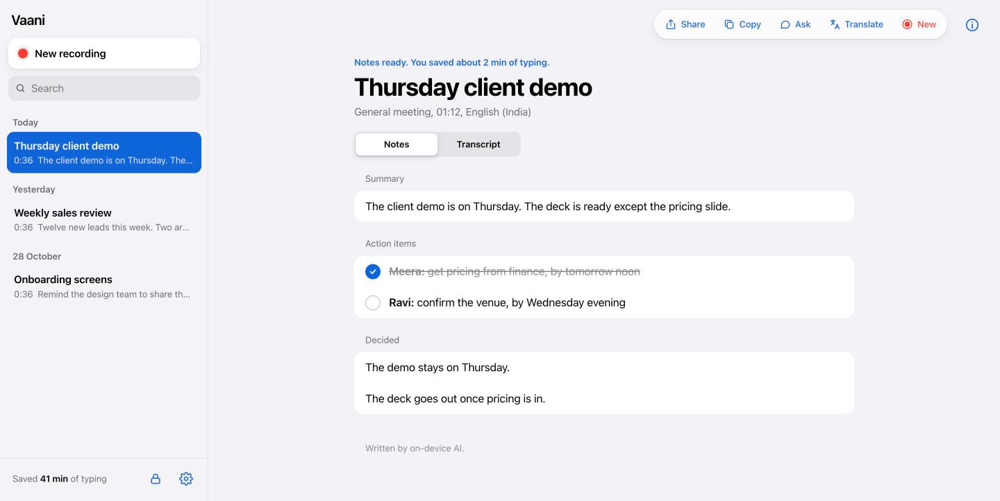
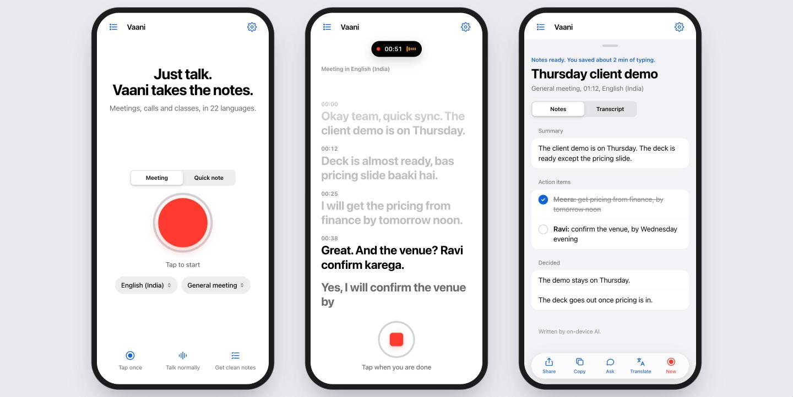

# Vaani

### Just talk. Vaani takes the notes.

**Free, open-source meeting notes and dictation in 22 languages, including Hindi, Hinglish, Kannada and Tamil.** 
Runs in your browser. No sign-up. No install. No bot joins your call.

### [▶ Try Vaani now, free](https://pradeep411.github.io/vaani/)

---

## Why Vaani?

Meetings in India switch languages mid-sentence. Most AI note-takers are paid, English-first, want an account, and send a bot into your call. Vaani is the opposite.

- **Free.** No plan, no trial, no credit card. Ever.
- **Speaks your language.** 22 languages, and it handles Hinglish-style mixing.
- **Private.** No Vaani server, no account. Your notes stay in your browser.
- **One tap.** A red button. Tap, talk, get notes. That's the whole app.

A free, open-source alternative to paid note-takers and dictation apps like Granola, Otter and Wispr Flow, built for how people actually talk.

## How it works

| 1. Tap | 2. Talk | 3. Get notes | 4. Share |
|:---:|:---:|:---:|:---:|
| Press the red button (or <kbd>⌘J</kbd> / <kbd>Ctrl J</kbd>) | Talk normally. Your words appear line by line | Summary, action items, decisions | WhatsApp, email, copy or download |

Screens show a sample meeting. The notes were written by an AI engine; the free basic engine gives simpler notes (see below).

## Features

- 🎙️ **Meeting mode**: live transcript, then notes with a summary, action items, decisions and open questions
- ✍️ **Quick note mode**: speak a thought, get clean, ready-to-send text you can edit
- ✅ **Tickable action items**: tick them off as they get done
- 💬 **Ask your meeting**: "What did Meera promise?"
- 🌐 **Translate notes** into 18 languages
- 📤 **Share anywhere**: WhatsApp, email, your phone's share sheet, copy, or download
- 🗂️ **Your notes, searchable**, grouped by day
- 🧠 **Knows what kind of meeting it was**: management, sales, client, developer, founders, customer support and more. Each gets its own format, with owners on every action item
- 🌙 **Light and dark mode**, phone and laptop layouts
- 📲 **Install it like an app** on your phone or computer (Add to Home Screen / Install)
- ⏱️ **Time saved counter**: see how much typing you skipped

## The notes engine: free by default, smarter with a key

Vaani never needs an API key. It picks the best engine available, in this order:

| Engine | Cost | Where it runs | What you get |
|---|---|---|---|
| **Your own AI key** (Sarvam AI, OpenAI, Claude or Gemini) | Your key | The provider you choose (text only) | The best notes, any language, Ask and Translate everywhere |
| **On-device AI built into Chrome** | Free | Your computer | Smart notes, Ask and Translate with no key (Chrome on a laptop or desktop that supports it) |
| **Vaani's basic engine** | Free | Your device, works offline | Summary, action items and decisions picked out of your words |

Add a key in **Settings → Notes engine**. It is saved only in your browser and sent only to that provider.

- Sarvam AI (best for Indian languages): [dashboard.sarvam.ai](https://dashboard.sarvam.ai)
- Google Gemini (has a free tier): [aistudio.google.com/apikey](https://aistudio.google.com/apikey)
- OpenAI: [platform.openai.com/api-keys](https://platform.openai.com/api-keys)
- Anthropic Claude: [console.anthropic.com/settings/keys](https://console.anthropic.com/settings/keys)

## Privacy: what runs where

We'd rather be precise than make big promises.

| Step | Where it happens |
|---|---|
| Speech to text | **Your browser's speech engine.** Chrome and Edge send the audio to Google or Microsoft to do this. Safari uses Apple's engine. Vaani itself never receives your audio. |
| Notes (free engines) | **On your device.** |
| Notes (your own key) | The **text** of the transcript goes to the provider you picked. Never the audio. |
| Saved notes | **Only in this browser** (local storage). Clearing browser data deletes them. |
| Accounts, tracking, analytics | **None.** There is no Vaani server. |

Please tell people when you are taking notes. It's polite, and in many places it's the law.

## Languages

English (India, US, UK), Hindi, Kannada, Tamil, Telugu, Marathi, Bengali, Gujarati, Malayalam, Punjabi, Urdu, Spanish, French, German, Arabic, Portuguese, Russian, Chinese, Japanese, Indonesian.

Speech recognition comes from your browser. **Chrome supports all 22**; support in Safari and Edge varies by language. Pick "English (India)" for Hinglish.

## Works best in

| Browser | Recording |
|---|---|
| Chrome (desktop and Android) | ✅ Best |
| Edge | ✅ |
| Safari (Mac and iPhone) | ✅ |
| Firefox | ❌ No built-in speech engine yet. Your saved notes still open. |

**Online calls:** a browser tab hears your microphone, so for a Zoom or Meet call, keep the call on your laptop speakers so Vaani can hear everyone. A desktop app that captures both sides of a call is on the roadmap.

## Run it yourself in 30 seconds

Vaani is one HTML file. No build step, no dependencies.

- **Use it:** [pradeep411.github.io/vaani](https://pradeep411.github.io/vaani/)
- **Host your own copy:** fork this repo → Settings → Pages → Deploy from branch → `main`, root. Done.
- **Run locally:** download the repo and open `index.html` in Chrome, or run `python3 -m http.server` in the folder and open `http://localhost:8000`.

## Roadmap

- [ ] Desktop app that captures both sides of an online call, without a bot
- [ ] Speaker names ("Priya", "Arjun") in the transcript
- [ ] Sarvam speech-to-text for higher accuracy in Indian languages (with your key)
- [ ] Export to Notion, Google Docs and Slack
- [ ] More languages: Odia, Assamese and more

Have an idea? [Open an issue](https://github.com/Pradeep411/vaani/issues).

## Contributing

The most useful help right now:

1. **Test it in your language** and [tell us](https://github.com/Pradeep411/vaani/issues) what it got wrong.
2. **Improve the basic engine** for your language (the word lists live in `basicNotes()` in `index.html`).
3. **Fix a bug or polish a screen.** See [CONTRIBUTING.md](CONTRIBUTING.md).

## If Vaani saved you time

⭐ **Star the repo.** It's the single best way to help other people find it. 
📤 **Share it** with one person who takes notes in meetings.

---

Built in Bengaluru by [Pradeep Zille](https://www.linkedin.com/in/pradeepzille). MIT licensed: use it, change it, share it.

